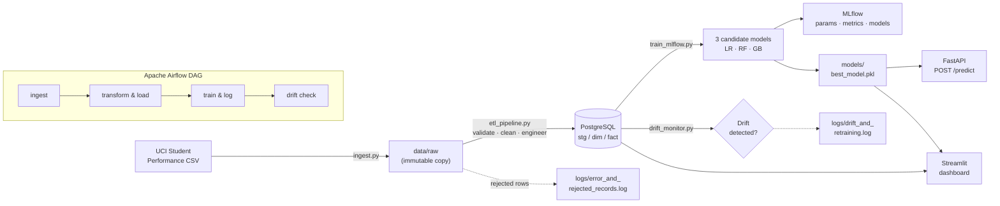
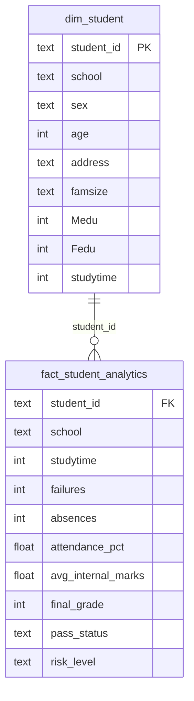

# 🎓 Student Performance Analytics & At-Risk Prediction

**An end-to-end data engineering + MLOps pipeline that flags students at academic risk early — from raw data to a live prediction API and dashboard.**


*Enter a student's details and the trained model returns their risk of failing in real time.*

---

## 💡 The Problem

Teachers usually find out a student is struggling after the final exam — when it's too late to help. This project builds the pipeline a school would need to spot at-risk students **during the term**, using signals like attendance, internal assessment marks, study time and past failures, and surfaces them on a dashboard and through an API that other systems can call.

## ✨ What It Does

| Stage | What happens | Code |
|---|---|---|
| **Ingest** | Pulls the UCI Student Performance dataset (395 students, 33 attributes), stores an immutable raw copy and writes an audit log | `src/ingest.py` |
| **Validate & Transform** | Rejects out-of-range grades / negative absences (logged), de-duplicates, engineers `attendance_pct`, `avg_internal_marks`, `pass_status`, `risk_level` | `src/etl_pipeline.py` |
| **Load** | Writes staging, dimension and fact tables to PostgreSQL | `src/etl_pipeline.py` |
| **Train & Track** | Trains Logistic Regression, Random Forest and Gradient Boosting on a stratified 80/20 split; logs params, metrics and models to MLflow; picks the champion by F1 | `src/train_mlflow.py` |
| **Monitor** | Compares current attendance and risk-rate against baselines and flags when retraining is needed | `src/drift_monitor.py` |
| **Orchestrate** | Runs all of the above as a 4-task Airflow DAG with retries | `dags/academic_analytics_dag.py` |
| **Serve** | FastAPI `/predict` endpoint with Pydantic input validation, containerised with Docker | `src/api.py` |
| **Visualise** | Streamlit dashboard: KPIs, filters, charts, an intervention list and a what-if risk calculator | `dashboard/app.py` |

---

## 🏗️ Architecture



## 🗄️ Data Model



A full cleaned copy is also kept in `stg_student_records` for auditing.

**How "at risk" is defined:** a student is labelled `High Risk` if their final grade is below 10/20 **or** their attendance is below 75% (attendance is derived from absences over 93 sessions). About 34% of students fall into this group.

---

## 📊 Results

All runs are tracked in MLflow under the `Student_Dropout_Risk_Prediction` experiment.

| Model | Role | Selected by |
|---|---|---|
| Logistic Regression | Baseline (on scaled features) | — |
| Random Forest | **Champion — F1 = 0.926** | Highest F1 on held-out test set |
| Gradient Boosting | Candidate | — |


> **Note on the score:** the strongest features (internal marks G1/G2) correlate ~0.89 with the final grade the label is built from, so this F1 reflects a *mid-term* prediction setting rather than a start-of-term one. See [Design decisions & limitations](#-design-decisions--limitations).

---

## 🖥️ Screenshots

**Airflow** — the 4-task DAG completing successfully


**Dashboard** — grade distributions by school and study time, plus the intervention list


---

## 🚀 Quick Start

### Option A — Just the prediction API (Docker)

```bash
git clone https://github.com/AK28-gif/student_analytics_performance_project.git
cd student_analytics_performance_project
docker compose up --build
```

Open **http://localhost:8000/docs** and try `POST /predict`:

```bash
curl -X POST http://localhost:8000/predict \
  -H "Content-Type: application/json" \
  -d '{"studytime": 2, "failures": 1, "absences": 12, "attendance_pct": 87.1,
       "avg_internal_marks": 8.5, "age": 17, "medu": 2, "fedu": 2}'
```

The response looks like this (the probability depends on the inputs):

```json
{
  "dropout_risk_prediction": "High Risk",
  "risk_probability": 0.83,
  "intervention_recommended": true
}
```

### Option B — Full pipeline (local)

**1. Install**

```bash
python3 -m venv venv && source venv/bin/activate
pip install -r requirements.txt
```

**2. Configure** — create a `.env` in the project root:

```env
DB_HOST=localhost
DB_PORT=5432
DB_NAME=student_db
DB_USER=your_postgres_user
DB_PASSWORD=your_postgres_password
```

**3. Create the database**

```bash
psql -h localhost -U your_postgres_user -c "CREATE DATABASE student_db;"
```

**4. Run the pipeline** — either through Airflow:

```bash
export AIRFLOW_HOME=$(pwd)
export AIRFLOW__CORE__DAGS_FOLDER=$(pwd)/dags
export AIRFLOW__CORE__LOAD_EXAMPLES=False
export AIRFLOW__WEBSERVER__WEB_SERVER_PORT=8085
airflow standalone
# open http://localhost:8085 and trigger "student_performance_data_pipeline"
```

…or step by step without Airflow:

```bash
python src/ingest.py
python src/etl_pipeline.py
python src/train_mlflow.py
python src/drift_monitor.py
```

**5. Explore the results**

| Service | Command | URL |
|---|---|---|
| MLflow UI | `mlflow ui --backend-store-uri file://$(pwd)/mlruns --port 5002` | http://127.0.0.1:5002 |
| Prediction API | `uvicorn src.api:app --reload --port 8005` | http://127.0.0.1:8005/docs |
| Dashboard | `streamlit run dashboard/app.py --server.port 8502` | http://localhost:8502 |

---

## 🔌 API Reference

| Method | Endpoint | Description |
|---|---|---|
| `GET` | `/` | Service info |
| `GET` | `/health` | Liveness check |
| `POST` | `/predict` | Returns risk label, probability and whether intervention is recommended |

All inputs are range-checked by Pydantic (e.g. `studytime` 1–4, `attendance_pct` 0–100, `avg_internal_marks` 0–20); invalid requests get a `422` with a clear error.

---

## 🧠 Design Decisions & Limitations

Things I chose deliberately, and things I'd improve next:

- **Airflow for orchestration** — gives retries, dependency ordering and run history for free, and mirrors how pipelines run in production.
- **MLflow file store instead of SQLite backend** — avoids SQLite locking errors when Airflow tasks write concurrently.
- **Champion picked by F1, not accuracy** — the classes are imbalanced (~34% at risk), and missing an at-risk student is costlier than a false alarm.
- **Data-quality gate before load** — bad rows are logged with a reason rather than silently dropped, so issues are auditable.
- **Label leakage (known limitation)** — the label is derived from the final grade and attendance, while the features include internal marks and absences. That makes the problem easier than a real early-warning setting. In a quick experiment, removing grade/absence features drops ROC-AUC from ~0.96 to ~0.63, and keeping only the first-term grade (G1) gives ~0.90 — a more honest "predict after the first test" scenario.
- **Drift check is rule-based** — it compares two summary statistics against fixed baselines. A statistical test per feature (KS / PSI) would be more robust.

## 🛣️ Roadmap

- [ ] Train on G1 only (no G2/absences) to model a true early-warning scenario
- [ ] Save the champion model + scaler from `train_mlflow.py` and register it in the MLflow Model Registry
- [ ] Wrap scaler + model in a single scikit-learn `Pipeline` so API and dashboard can't drift apart
- [ ] Per-feature drift detection with Evidently (PSI / KS tests) and auto-trigger retraining from the DAG
- [ ] Add PostgreSQL, MLflow and the dashboard to `docker-compose.yml` for a one-command setup
- [ ] Unit tests (pytest) for ETL validation and the API, run in GitHub Actions CI
- [ ] SHAP explanations so teachers see *why* a student was flagged

---

## 📁 Project Structure

```text
student_analytics_performance_project/
├── dags/
│   └── academic_analytics_dag.py   # Airflow DAG: ingest → ETL → train → monitor
├── dashboard/
│   └── app.py                      # Streamlit dashboard + what-if predictor
├── data/
│   └── raw/                        # Immutable copy of the source dataset
├── models/                         # Serialized champion model, scaler, metadata
├── src/
│   ├── ingest.py                   # Data ingestion + audit log
│   ├── etl_pipeline.py             # Validation, feature engineering, Postgres load
│   ├── train_mlflow.py             # Model training + MLflow tracking
│   ├── drift_monitor.py            # Drift checks + retraining flag
│   ├── api.py                      # FastAPI inference service
│   └── run_pipeline.py             # Run ingest + ETL without Airflow
├── Dockerfile                      # API container
├── docker-compose.yml
└── requirements.txt
```

## 📚 Dataset

[UCI Machine Learning Repository — Student Performance](https://archive.ics.uci.edu/dataset/320/student+performance) (Cortez & Silva, 2008). Mathematics course records for 395 secondary-school students in Portugal: demographics, family background, study habits, absences, and three term grades (G1, G2, G3).

## 👩‍💻 Author

**Aishwarya Kotte** — B.E. Artificial Intelligence, CMR Institute of Technology, Bengaluru
Built as an individual project for the Data Engineering & MLOps course.

[](https://www.linkedin.com/in/aishwarya-kotte-2291a9373/)
[](https://github.com/AK28-gif)
